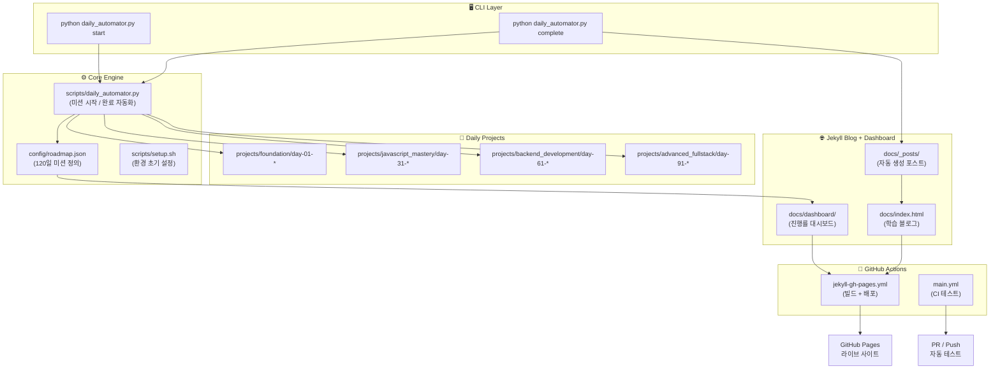

<div align="center">

# 120-Day Fullstack Web Developer Mastery

**120일 만에 완전한 풀스택 웹 개발자로 성장하는 체계적 커리큘럼 + 자동화 학습 시스템**

[](config/roadmap.json)
[](#-tech-stack)
[](https://Reasonofmoon.github.io/120day-fullstack-web-developer-mastery)
[](https://Reasonofmoon.github.io/120day-fullstack-web-developer-mastery/dashboard)
[](.github/workflows)
[](package.json)

<br />

> *"하루 1시간, 120일이면 누구나 풀스택 개발자가 될 수 있다."*

[블로그 보기](https://Reasonofmoon.github.io/120day-fullstack-web-developer-mastery) &nbsp;&bull;&nbsp; [대시보드 보기](https://Reasonofmoon.github.io/120day-fullstack-web-developer-mastery/dashboard) &nbsp;&bull;&nbsp; [시작하기](#-getting-started)

</div>

---

## 🧭 Philosophy &mdash; 철학

대부분의 "웹 개발 입문" 자료는 **강의 수백 시간을 나열**할 뿐, 매일 무엇을 만들어야 하는지 알려주지 않습니다.
이 프로젝트는 **"오늘 뭘 해야 하지?"를 영원히 제거**합니다. 120일치 미션이 JSON 로드맵에 사전 정의되어 있고, Python 자동화가 매일의 프로젝트 폴더 생성 / 블로그 포스팅 / Git 커밋까지 대신 처리합니다.

| 비교 항목 | 일반 부트캠프 / 강의 | **120-Day Mastery** |
|:---:|:---:|:---:|
| 학습 구조 | 영상 수백 편, 순서 불명확 | **120일 일일 미션 JSON 로드맵** |
| 실습 프로젝트 | 강사 따라하기 | **매일 자동 생성되는 실습 프로젝트** |
| 학습 기록 | 노션 / 메모장 수동 관리 | **자동 블로그 포스트 생성 + 대시보드** |
| 진행률 추적 | 스스로 체크 | **실시간 프로그레스 대시보드 (120칸 그리드)** |
| 배포 자동화 | 없음 | **GitHub Actions CI/CD 자동 배포** |
| 비용 | 수십~수백만 원 | **완전 무료, 오픈소스** |

---

## 🏗️ Architecture &mdash; 아키텍처



---

## 🎯 Phase Features &mdash; 단계별 학습 내용

### Phase 1: Foundation (Day 1-30) &mdash; 웹 개발 기초

| 주제 | 내용 |
|:---|:---|
| How The Web Works | HTTP/HTTPS, DNS, 클라이언트-서버 아키텍처 이해 |
| HTML5 & Semantic HTML | 시맨틱 태그, 접근성(a11y), SEO 기초 |
| CSS3 Essentials | 셀렉터, 박스 모델, 포지셔닝, 변수 |
| Flexbox & Layout | Flexbox, Grid 레이아웃 실전 |
| CSS Animations | 트랜지션, 키프레임 애니메이션 |
| Responsive Design | 미디어 쿼리, 모바일 퍼스트 |
| CSS Frameworks | Bootstrap 4 & 5 실전 프로젝트 |

> **Wow Moment** : Day 1부터 `node server.js` 한 줄로 실제 HTTP 서버를 띄우고 "Hello, World!"를 브라우저에서 확인합니다.

### Phase 2: JavaScript Mastery (Day 31-60) &mdash; JavaScript 완전정복

| 주제 | 내용 |
|:---|:---|
| JavaScript Basics | 변수, 타입, 조건문, 반복문 |
| Modern JS Syntax | ES6+ 화살표 함수, 디스트럭처링, 스프레드 |
| DOM Manipulation | 이벤트 핸들링, 동적 UI 구성 |
| Asynchronous JS | Promise, async/await, 이벤트 루프 |
| AJAX & JSON | Fetch API, 데이터 파싱 |
| Working with APIs | RESTful API 호출, 외부 서비스 연동 |

> **Wow Moment** : 외부 API를 호출해 실시간 데이터를 화면에 렌더링하는 SPA를 직접 만듭니다.

### Phase 3: Backend Development (Day 61-90) &mdash; 백엔드 개발

| 주제 | 내용 |
|:---|:---|
| Terminal & Unix | 커맨드라인 능숙하게 다루기 |
| Node.js & NPM | 런타임 이해, 패키지 관리 |
| Express.js | 라우팅, 미들웨어, 템플릿 엔진 |
| RESTful APIs | CRUD API 설계 및 구현 |
| Databases & MongoDB | NoSQL 개념, CRUD 쿼리, 스키마 설계 |

> **Wow Moment** : Express + MongoDB로 완전한 RESTful CRUD API를 설계하고, Postman으로 테스트합니다.

### Phase 4: Advanced Fullstack (Day 91-120) &mdash; 고급 풀스택

| 주제 | 내용 |
|:---|:---|
| Security | XSS, CSRF, SQL Injection 방어 |
| Authentication & Authorization | Passport.js, JWT, 세션/쿠키 |
| Cloud Deployment | MongoDB Atlas, Heroku/Render 배포 |
| Image Upload | Multer, Cloudinary 연동 |
| Geocoding & Maps | Mapbox/Google Maps API 통합 |

> **Wow Moment** : 인증 + 이미지 업로드 + 지도 통합이 포함된 풀스택 캠핑장 리뷰 사이트를 완성합니다.

---

## 🚀 Getting Started

### Starter &mdash; 빠른 시작 (5분)

```bash
# 1. 저장소 클론
git clone https://github.com/Reasonofmoon/120day-fullstack-web-developer-mastery.git
cd 120day-fullstack-web-developer-mastery

# 2. 오늘의 학습 미션 시작
python scripts/daily_automator.py start
```

### Professional &mdash; 전체 환경 구성

```bash
# 1. 저장소 클론
git clone https://github.com/Reasonofmoon/120day-fullstack-web-developer-mastery.git
cd 120day-fullstack-web-developer-mastery

# 2. 자동 환경 설정 (Node.js, Python venv, Git 초기화)
bash scripts/setup.sh

# 3. 오늘의 미션 시작
python scripts/daily_automator.py start

# 4. 학습 완료 후 (블로그 포스트 자동 생성 + Git 커밋/푸시)
python scripts/daily_automator.py complete
```

### Enterprise &mdash; 로컬 블로그 + 대시보드 서버

```bash
# 1. Professional 단계 완료 후
# 2. Jekyll 로컬 서버 실행
cd docs
bundle install
bundle exec jekyll serve

# 3. 브라우저에서 확인
#    블로그    → http://localhost:4000
#    대시보드  → http://localhost:4000/dashboard
```

---

## ⚙️ Customization &mdash; 커스터마이징

| 항목 | 파일 | 설명 |
|:---|:---|:---|
| 커리큘럼 수정 | `config/roadmap.json` | 120일 미션 주제, 난이도, 예상 시간 수정 |
| 시작 날짜 변경 | `config/roadmap.json` → `start_date` | 학습 시작 날짜 조정 |
| 블로그 테마 | `docs/_config.yml` | Jekyll 테마, 타이틀, 설명 변경 |
| 스타일 커스텀 | `docs/assets/css/style.css` | CSS 변수로 색상/폰트 일괄 변경 |
| 대시보드 로직 | `docs/dashboard/script.js` | 진행률 계산, 그리드 렌더링 수정 |
| CI/CD 파이프라인 | `.github/workflows/*.yml` | 빌드/배포 워크플로우 커스텀 |
| 자동화 스크립트 | `scripts/daily_automator.py` | 미션 시작/완료 로직 확장 |

---

## 📂 Project Structure &mdash; 프로젝트 구조

```
120day-fullstack-web-developer-mastery/
├── .github/
│   └── workflows/
│       ├── jekyll-deploy.yml        # Jekyll 빌드 + 배포
│       ├── jekyll-gh-pages.yml      # GitHub Pages 배포 (메인)
│       └── main.yml                 # CI 파이프라인 (테스트)
├── config/
│   └── roadmap.json                 # 120일 전체 커리큘럼 + 일일 미션 정의
├── docs/
│   ├── _config.yml                  # Jekyll 사이트 설정
│   ├── _layouts/
│   │   └── default.html             # 블로그 레이아웃 템플릿
│   ├── _posts/
│   │   └── 2025-07-24-day-1-*.md    # 자동 생성 학습 블로그 포스트
│   ├── assets/css/
│   │   └── style.css                # 블로그 + 대시보드 스타일
│   ├── dashboard/
│   │   ├── index.html               # 진행률 대시보드 UI
│   │   └── script.js                # 120칸 그리드 렌더링 + 진행률 계산
│   ├── index.html                   # 블로그 메인 페이지
│   └── Gemfile                      # Ruby/Jekyll 의존성
├── projects/
│   └── foundation/
│       └── day-01-how-the-web-works/
│           ├── .gitignore           # node_modules 제외
│           ├── package.json         # 프로젝트 설정
│           └── server.js            # HTTP 서버 실습 코드
├── scripts/
│   ├── daily_automator.py           # 일일 학습 자동화 (미션 시작/완료)
│   └── setup.sh                     # 초기 환경 설정 스크립트
├── MANUAL.md                        # 일일 학습 매뉴얼
├── package.json                     # 루트 프로젝트 설정
└── README.md
```

---

## 📊 Numbers &mdash; 프로젝트 규모

| 항목 | 수치 |
|:---:|:---:|
| 총 학습 일수 | **120일** |
| 커리큘럼 Phase | **4단계** |
| 일일 미션 (JSON 정의) | **120개** |
| 다루는 핵심 토픽 | **30+ 주제** |
| 일일 예상 학습 시간 | **약 60분** |
| GitHub Actions 워크플로우 | **3개** |
| 자동화 스크립트 | **2개** (Python + Bash) |
| Jekyll 블로그 페이지 | **블로그 + 대시보드** |

---

## 📋 Requirements &mdash; 실행 환경

| 도구 | 버전 | 용도 |
|:---|:---|:---|
| **Node.js** | 18.x 이상 | 프로젝트 실행, npm 패키지 관리 |
| **Python** | 3.8 이상 | 일일 자동화 스크립트 실행 |
| **Git** | 최신 | 버전 관리, GitHub 연동 |
| **Ruby** | 3.1 이상 | Jekyll 로컬 블로그 서버 (선택) |
| **Bundler** | 최신 | Jekyll 의존성 관리 (선택) |

---

## 🛡️ Tech Stack

| 레이어 | 기술 |
|:---|:---|
| **Frontend** | HTML5, CSS3, JavaScript (ES6+), Bootstrap |
| **Backend** | Node.js, Express.js |
| **Database** | MongoDB, Mongoose |
| **Blog Engine** | Jekyll + GitHub Pages |
| **Dashboard** | Vanilla JS + CSS Grid |
| **Automation** | Python (daily_automator.py) |
| **CI/CD** | GitHub Actions (3 workflows) |
| **Infra** | GitHub Pages, MongoDB Atlas |

---

## 🌍 i18n &mdash; 다국어

| 언어 | 지원 범위 |
|:---|:---|
| 🇰🇷 한국어 | 커리큘럼 설명, 미션 제목, 매뉴얼, README |
| 🇺🇸 English | 코드 주석, 블로그 템플릿, 기술 용어 |

---

## 🤝 Contributing &mdash; 기여하기

1. 이 저장소를 **Fork** 합니다
2. 기능 브랜치를 생성합니다 (`git checkout -b feature/amazing-feature`)
3. 변경사항을 커밋합니다 (`git commit -m 'Add amazing feature'`)
4. 브랜치에 푸시합니다 (`git push origin feature/amazing-feature`)
5. **Pull Request** 를 생성합니다

> 커리큘럼 개선, 새로운 미션 추가, 자동화 기능 확장 등 모든 기여를 환영합니다.

---

## 📄 License

이 프로젝트는 [ISC License](https://opensource.org/licenses/ISC) 하에 배포됩니다.

---

<div align="center">

**120일의 여정, 하루에 1시간이면 충분합니다.**

Built with persistence by [@Reasonofmoon](https://github.com/Reasonofmoon)

</div>
